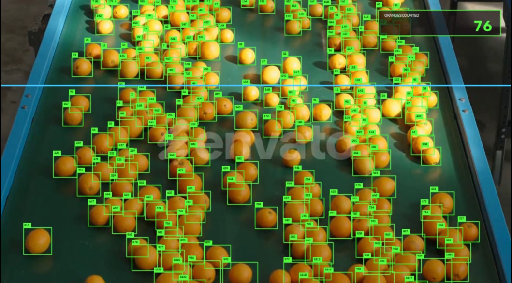

# 🍊 Orange Counting Using YOLO

A computer vision project that uses YOLO-based object detection to identify and count oranges in video footage. The system detects individual oranges, draws bounding boxes around them, and generates annotated output for visual analysis.

## 📌 Project Overview

Counting fruits manually on a conveyor belt or in production environments can be time-consuming. This project explores how computer vision can automate orange detection and counting from video footage.

Using a trained YOLO model and OpenCV, the system processes video frames, detects oranges, and produces visual results showing the detected objects.

## ✨ Features

- **Orange Detection:** Detects oranges in video frames using a trained YOLO model.
- **Visual Bounding Boxes:** Draws boxes around detected oranges.
- **Automated Counting:** Counts detected oranges in the processed footage.
- **Video Processing:** Processes input video and generates an annotated output video.
- **Visual Results:** Saves detection images and processed video for analysis.

## 🛠️ Technologies Used

- Python
- YOLO (Ultralytics)
- OpenCV
- Google Colab
- Jupyter Notebook

## 📂 Project Structure

```text
Orange-Counting-YOLO/
├── orange_counting_yolo.ipynb
├── best (3).pt
├── Test_video/
│   └── oranges.mp4
├── Output/
│   ├── image1.png
│   └── oranges_linkedin_final (2).mp4
├── README.md
└── .gitignore
```

## 🖼️ Detection Results

The following image demonstrates the project's orange detection output.



## 🎥 Output Video

The project generates an annotated video showing the orange detection results.

[▶️ View the Processed Orange Counting Video](<Output/oranges_linkedin_final (2).mp4>)

## 🚀 Getting Started

### 1. Clone the Repository

```bash
git clone YOUR_GITHUB_REPOSITORY_URL
cd orange-counting-yolo
```

Replace `YOUR_GITHUB_REPOSITORY_URL` with your actual GitHub repository URL.

### 2. Install Dependencies

```bash
pip install ultralytics opencv-python
```

### 3. Open the Notebook

Open `orange_counting_yolo.ipynb` in Google Colab or Jupyter Notebook.

### 4. Configure the Files

Make sure the paths to the trained model, input video, and output directory match your environment.

The repository includes the trained model weights and a sample test video.

### 5. Run the Notebook

Execute the notebook cells to load the model, process the video, detect oranges, and generate the annotated results.

## 💡 Potential Applications

- Fruit counting in agricultural settings
- Automated fruit sorting and processing
- Conveyor-belt monitoring
- Computer vision-based production workflows
- Exploring automation in food-processing environments

## 🔮 Future Improvements

- Improve detection accuracy under different lighting conditions.
- Add object tracking to reduce duplicate counts across video frames.
- Evaluate performance on videos with different conveyor speeds and orange densities.
- Extend the system to classify fruit quality or ripeness.
- Explore real-time deployment for industrial applications.

## 👩‍💻 Author

**Nimra Faryal**

Computer Science Graduate | AI/ML | Computer Vision | Python Development

GitHub: [nimrafaryal](https://github.com/nimrafaryal)

LinkedIn: [Connect with me](https://www.linkedin.com/in/nimra-faryal-47494225b/)

---

*This project was developed as a practical exploration of YOLO-based object detection and computer vision for automated fruit counting.*